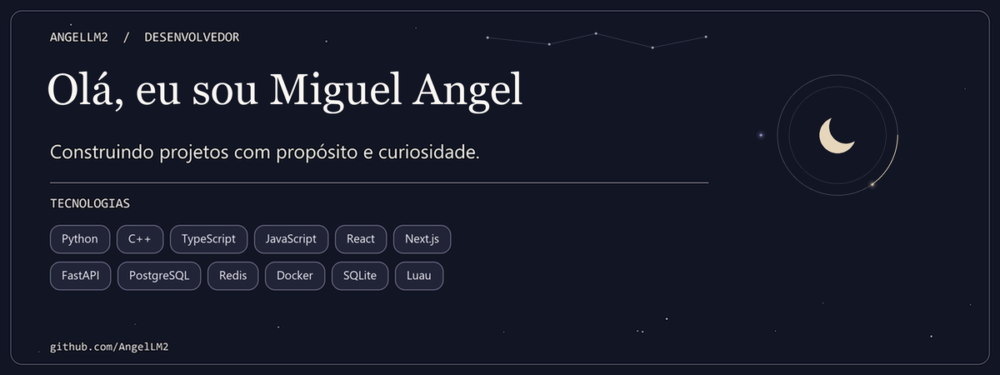

  

## Projetos em destaque

- [Lux Delivery](https://github.com/AngelLM2/Lux-Delivery) — plataforma de delivery com pedidos em tempo real e painel de operação.
- [Ricing Manager for Windows](https://github.com/AngelLM2/RicingManagerWindows) — personalização do Windows com rices, barra própria e plugins.

## Tecnologias

Python · C++ · TypeScript · JavaScript · React · Next.js · FastAPI · PostgreSQL · Redis · Docker · SQLite · Luau
